<h1 align="center">An AI agent that runs on a permission you sign, not your keys</h1>

<p align="center">
  <a href="https://docs.proofable.me/benchmark"></a>
  <a href="https://proofable.me/benchmarks/memory"></a>
  <a href="https://proofable.me/benchmarks/governance"></a>
  <a href="https://proofable.me/benchmarks/security"></a>
  <a href="https://docs.proofable.me/benchmark"></a>
  <a href="https://docs.proofable.me/benchmark"></a>
</p>

<p align="center">
  <a href="https://www.npmjs.com/package/@proofable/sdk"></a>
  <a href="https://github.com/proofable/sdk/blob/main/LICENSE"></a>
  <a href="https://docs.proofable.me"></a>
  <a href="https://discord.gg/cpNJVuq4UW"></a>
</p>

<p align="center">
  <a href="https://proofable.me">Website</a>
  |
  <a href="https://docs.proofable.me">Docs</a>
  |
  <a href="https://docs.proofable.me/benchmark">Benchmarks</a>
  |
  <a href="https://github.com/proofable/agent">Agent template</a>
  |
  <a href="https://codespaces.new/proofable/agent">Open in Codespaces</a>
</p>

<p align="center">
  <picture>
    <source media="(prefers-color-scheme: dark)" srcset="images/terminal-dark.svg">
    
  </picture>
</p>

⭐ *Help us reach more developers. Star this repo!*

Proofable checks every action this agent takes, from your AI tools, a hosted runtime or CI, against a permission you sign, outside the agent and before it runs, and leaves a signed receipt anyone can verify offline.

**Agents that can't do what you never allowed.**

---

## Where it stands

| Benchmark | Result |
|---|---|
| **NVIDIA Agent Gauntlet** | Winner. The top score of the tournament, 98.00, across 20 teams and 11 live heats, with every call checked before it ran |
| **Agent memory** (PrecisionMemBench) | **77 of 77** cases. Hindsight passed 66 on the same open toolkit; Mem0 and Zep passed 9. Finding the current rule takes 11.1× fewer tokens than searching every record |
| **Agent rules** (AgentGovBench) | **48 of 48** scenarios. The best gateway handled 46; coding agents on their own handled 13 |
| **AgentDojo**, same model | **93.8%** of injected attacks stopped, against 83.6% for the same agent without Proofable, with 87% of tasks still done |
| **Hijacked agent** | **0 of 6** data-theft attempts got out, against 6 of 6 on an all-purpose key |
| **Forgery test** | **150 of 150** forged receipts caught. [Run it yourself](https://github.com/proofable/docs/tree/main/public/evidence/checks), no account needed |

Charts and side-by-side comparisons: [proofable.me/benchmarks](https://proofable.me/benchmarks). Sources, method and a public proof for every row: [docs.proofable.me/benchmark](https://docs.proofable.me/benchmark).

---

## Overview

The permission lives with Proofable, not with the runtime. Run the agent anywhere and the same limits hold in each place. Revoke it once and every copy stops. A prompt-injected agent still can't cross the line, because the decision is made outside its process.

**Key Capabilities:**

- **Its own identity** - a key and a signed identity tied to you, created by `npm run setup`
- **A permission instead of a key** - the actions it may take, a spend cap and an end date, checked before every call
- **Isolated computer** - jobs can run on a sealed machine with a checked-out repository
- **Receipts that verify offline** - `npm run verify` checks a run with no network and no account
- **Trust checks in CI** - the live permission cases and the prompt injection test on every pull request that changes `agent.json`

Click **Use this template** for your own copy, or [open it in Codespaces](https://codespaces.new/proofable/agent).

---

## Quick start

You need Node 20 or later and a Proofable account (free, with 500 credits a month). Create an access key under [Profile, Account, Access keys](https://proofable.me/profile?tab=account) and keep it in your shell.

```bash
npm install
export PROOFABLE_ACCESS_KEY=npk_...
npm run setup
npm run status
npm run job -- "Run the tests and report each exit code" --repo proofable/mcp
npm run verify
```

`setup` gives the agent its own key in `.agent/` and signs its identity, then prints a link. Open the link, check the limits, and sign with your wallet. Commit `agent.json` afterwards. It holds the agent's public account. Each job is one hosted run paid from your credits.

## Run it anywhere

The agent lives on Proofable. Its identity, its permission and its receipts are records any runtime reads, so there is nothing to deploy. Every runtime gets the same limits, and revoking the permission stops all of them at once. The agent's own key never leaves the machine that ran `setup`.

**From any app, server or runtime**, one call talks to the agent. The turn runs on Proofable as the agent, checks every tool call against the permission before it runs, and cites the records it read:

```js
import { ProofableClient } from '@proofable/sdk';

const client = new ProofableClient({ apiKey: process.env.PROOFABLE_ACCESS_KEY });
const turn = await client.agentChat({
  agentId: 'proofable-agent',
  messages: [{ role: 'user', content: 'What did the last run find?' }],
});
console.log(turn.answer, turn.citations);
```

[Talk to your agent from any app](https://docs.proofable.me/agents/talk-to-an-agent) covers the HTTP call, the events and the costs.

**In your AI tools**:

```bash
npx -y @proofable/sdk mount proofable-agent --apply claude
```

`--apply` takes `claude`, `cursor`, `codex`, `hermes`, `openclaw`, or `opencode`; VS Code uses `cursor`.

**From this repository**, `npm run job` runs a task as the agent on an isolated computer, and `npm run verify` checks its receipt offline. Give each place you run it its own access key, so you can revoke one without the others.

## Already run an agent?

Bring it as it is: a GitHub repository, an MCP server URL, an A2A agent card, or a package. Secrets stay out of the import.

```bash
npx -y @proofable/sdk auth --oauth
npx -y @proofable/sdk import <repository, URL, or folder>
npx -y @proofable/sdk mount <agentId> --apply claude
```

`import` prints a link to register the agent's identity.

## Commands

| Command | What it does |
|---|---|
| `setup` | Creates the agent's key and identity, then prints the permission link |
| `permit` | Prints the link again, to renew the permission or sign new limits |
| `status` | Shows the permission and which actions it allows or refuses |
| `job "<task>"` | Runs a task. `--repo owner/name` checks out a public repository on an isolated computer (`--ref` picks the commit); `--computer` asks for one without a repository. |
| `verify` | Checks the latest run's receipt and dispatch decision offline, with no network and no account. Pass a folder under `runs/` to check another run. |
| `listing` | Saves an AI service listing that runs as this agent, as a draft. `-- --publish` puts it live. |

## Make it yours

Edit `agent.json`, then run `npm run setup`.

| Field | Sets |
|---|---|
| `agentId`, `label`, `description`, `instructions` | Who the agent is and how it behaves |
| `permission.actions` | The only actions it may take; anything else is refused before it runs |
| `permission.expiresInDays` | When access ends. Leave it out and the permission has no end date until you revoke it. |
| `permission.maxSpend` | Spend cap in USDC base units (`1000000` is 1 USDC); `0` for an agent that never pays |
| `listing` | The service buyers order: name, description, the repository input, and the prompt each order runs |

## CI

Add your access key as a repository secret named `PROOFABLE_ACCESS_KEY`. The **Trust checks** workflow runs Proofable's eight live permission cases and the prompt injection test on your account. It fails when an attack gets past the scoped permission. Run it from the Actions tab; it also runs on pull requests that change `agent.json`. It starts 12 hosted jobs.

## Learn more

- [Docs](https://docs.proofable.me)
- [Benchmark](https://docs.proofable.me/benchmark): Proofable's published results for these checks
- [Prompt injection test](https://github.com/proofable/mcp/tree/main/examples/injection-test)

Apache-2.0
